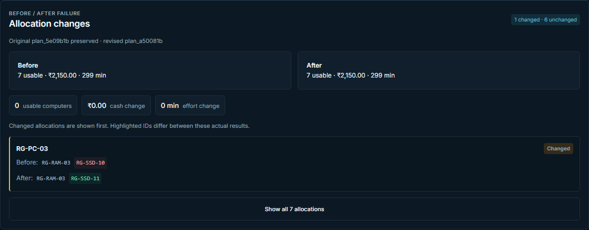
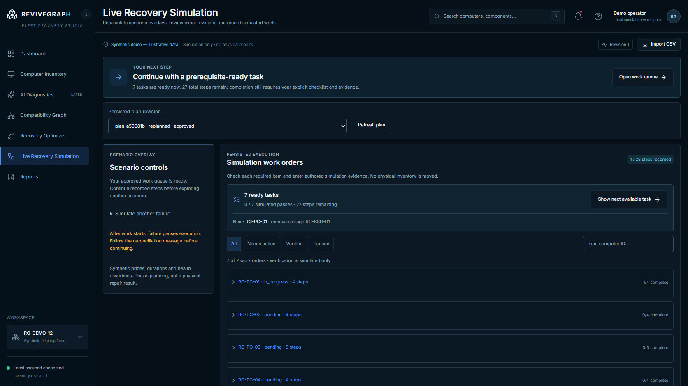

# ReviveGraph

### Recover more from the computers you already have.

ReviveGraph helps colleges and refurbishment centres plan how to recover usable desktop computers from a fleet of damaged machines. It checks component compatibility, evidence, ownership, cost and technician time before recommending a repair plan.

**Built by:** GJV Pavan Sai · solo participant · Hackyard Build 2026, IIT Guwahati<br>
**Demo:** [Open ReviveGraph](https://revivegraph-demo.vercel.app/) · [GitHub repository](https://github.com/pavansai20052004-hue/ReviveGraph) · [Figma design](https://www.figma.com/design/Z3UwUmtqAq7HsMWLeYgcpV)


*Dashboard from a synthetic workflow. All counts, costs and outcomes are illustrative; no physical repairs are represented.*

> **Demo data:** The hosted demo uses a temporary shared Render backend. It may contain synthetic rehearsal records or reset after the free service sleeps or restarts. Use synthetic data only, and export the audit you need before leaving.

## What it does

ReviveGraph treats the fleet as one recovery problem instead of evaluating each computer in isolation. Its deterministic rules enforce supported desktop RAM and storage compatibility, distinguish health from compatibility, and prevent a physical part from being allocated twice. The optimizer compares recovery plans against hard budget and technician-time limits.

The supported demo flow is:

```text
Import inventory → Review evidence → Inspect compatibility → Calculate a plan
→ Simulate a donor failure → Compare a revised plan → Approve the plan
→ Complete simulated work orders → Record simulated verification → Export the audit
```

### Example synthetic calculation

For the versioned fixture of **12 computers and 31 components**, a validated run with a **₹2,500 budget** and **330 technician minutes** produced **7 usable final configurations**, at an assumed **₹2,150** and **299 minutes**. The same-input greedy baseline also produced 7. These are solver results for authored synthetic inputs, not measured repair outcomes or evidence of improvement over the baseline.

The fixture starts with 0 computers classified usable, 8 classified unusable and 4 with unknown usability. “Unusable” and health labels describe the synthetic data only; they are not diagnoses of real machines.

## Screenshots

<p align="center">
  
  
</p>

More desktop and mobile captures are available in [`docs/implementation-previews`](docs/implementation-previews/).

## Technology

| Layer | Technology | Responsibility |
| --- | --- | --- |
| Frontend | React, TypeScript, Vite, Tailwind CSS, Radix UI primitives, Lucide | Responsive recovery workspace |
| Compatibility graph | React Flow | Visual inspection of deterministic hardware decisions |
| API and storage | Python, FastAPI, SQLite | Versioned inventory, plans, workflow records and audit history |
| Optimizer | Google OR-Tools CP-SAT | Fleet-wide allocation under fixed cash and time limits |
| Charts | Recharts | Actual saved plan comparisons; no fabricated history |

The initial hardware model supports DDR3/DDR4 non-ECC unbuffered desktop UDIMM memory and 2.5-inch SATA storage. Unknown health or decisive compatibility information blocks allocation. The solver and compatibility layer do not rely on an LLM.

## Run locally on Windows

Requires Python 3.12 or newer and a recent Node.js LTS release. From the repository root:

```powershell
.\scripts\setup.ps1
```

Start the backend and frontend in separate PowerShell terminals:

```powershell
.\scripts\start-backend.ps1
```

```powershell
.\scripts\start-frontend.ps1
```

Open [http://127.0.0.1:5173](http://127.0.0.1:5173). The API documentation is at [http://127.0.0.1:8000/docs](http://127.0.0.1:8000/docs). Stop the services with **Ctrl+C**.

Setup from the locked dependencies without helper scripts:

```powershell
python -m venv .venv
.\.venv\Scripts\python.exe -m pip install -r backend\requirements.lock.txt
npm --prefix frontend ci
```

The application does not automatically seed the fixture. Use the CSV import flow to add the synthetic computers and components. For isolated rehearsal data, set `REVIVEGRAPH_DB` in the backend process before startup; keep your normal database unchanged.

## Integration status

| Service | How it was used | Current status |
| --- | --- | --- |
| **Adaption** | A 12-example synthetic dataset maps varied recovery questions to canonical plan fact IDs. | One adaptation run succeeded after an estimate of 1 credit and 11 minutes. The provider reported dataset scores of 4.0 → 8.6 (D → B); this does **not** measure ReviveGraph answer accuracy or hardware diagnosis. Actual billing usage was not returned. The accepted artifact is retained, but the app does not run Adaption inference. [Record](docs/ADAPTION_INTEGRATION.md) |
| **Nodus** | An optional CPU-job adapter and output validation were prepared around the existing CP-SAT solver. | No real Nodus job ran because account activation required payment-card verification. Nodus cloud execution is postponed; it is not needed for the demo. [Record](docs/NODUS_INTEGRATION.md) |
| **Agent37** | Used during frontend design and explored for selecting relevant facts from a saved plan. | Its runtime integration was removed. No Agent37 assistant or external AI request is active in the app. |
| **Render** | Hosts the temporary backend API used by the Vercel demo. | The API is live. Render Workflows source and local validation exist, but no hosted workflow was deployed because billing details were required. |

Compatibility, eligibility, resource accounting and allocation are deterministic. Provider-generated text cannot change component health, hardware compatibility, solver output, human decisions or physical repair records. AI diagnosis and autonomous AI remain deferred; environmental savings and physical verification are not claimed.

## Validation

The recorded validation covers the synthetic fixture, backend tests, frontend typecheck and production build, and browser flows for import, calculation, failure replanning, approval, work orders, simulated verification and audit export. Automated test evidence is explicitly synthetic, not participant-entered technician evidence. See [local product status](docs/LOCAL_PRODUCT_STATUS.md) and the [onsite work record](ONSITE_WORK.md) for dated commands and results.

## Project map

| Path | Contents |
| --- | --- |
| `frontend/` | React application and browser tests |
| `backend/` | FastAPI service, compatibility rules, optimizer and persistence |
| `datasets/synthetic-v1/` | Versioned synthetic inventory and scenarios |
| `docs/` | Product, architecture, design, fixture, validation and deployment records |
| `scripts/` | Windows setup/start commands and fixture utilities |
| `workflows/` | Prepared Render workflow source; not a live hosted workflow |
| `PRE_EVENT_WORK.md` | Work completed before the event |
| `ONSITE_WORK.md` | Dated event work and provider status |

## Project records

- [Implementation status, including all 18 planned capabilities](docs/IMPLEMENTATION_STATUS.md)
- [Product specification](docs/PRODUCT_SPEC.md) · [Architecture](docs/ARCHITECTURE.md) · [Build plan](docs/BUILD_PLAN.md)
- [Synthetic fixture specification](docs/FIXTURE_SPEC.md) · [UI plan and design references](docs/UI_PLAN.md)
- [Adaption integration](docs/ADAPTION_INTEGRATION.md) · [Nodus integration](docs/NODUS_INTEGRATION.md) · [Render deployment](docs/RENDER_WEB_DEPLOYMENT.md)
- [Pre-event disclosure](PRE_EVENT_WORK.md) · [Onsite work record](ONSITE_WORK.md)

## License

No license is currently provided. Public visibility does not grant permission to reuse or redistribute this project.
