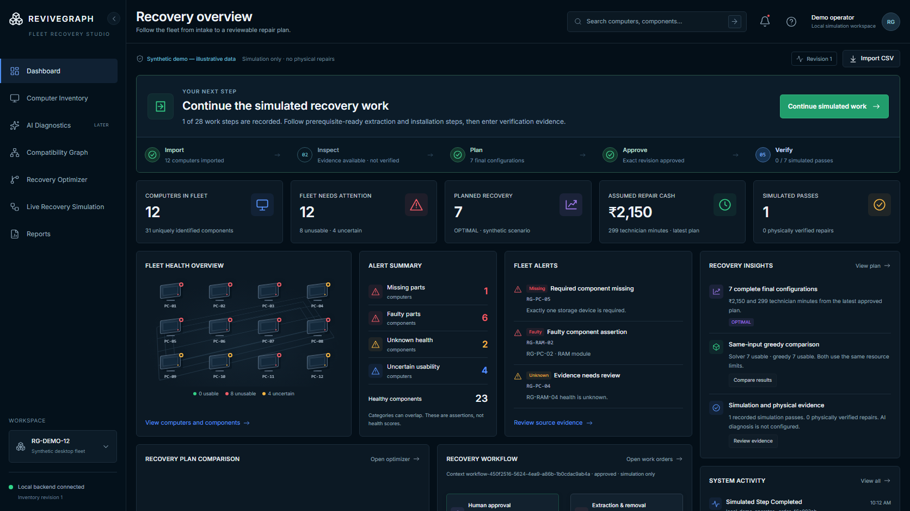

# ReviveGraph

### Recover more from the computers you already have.

ReviveGraph is a fleet-level recovery planner for colleges and refurbishment centres. It helps a technician find compatible, healthy parts across damaged desktop computers, then compares repair options against a cash budget and technician-time limit.

**Built by:** GJV Pavan Sai · solo participant · Hackyard Build 2026, IIT Guwahati<br>
**Demo:** [revivegraph-demo.vercel.app](https://revivegraph-demo.vercel.app/) · [Source on GitHub](https://github.com/pavansai20052004-hue/ReviveGraph)

> **Synthetic demo.** The public demo uses illustrative fleet data and a temporary shared backend. It is not a record of physical repairs. Import the synthetic fixture to begin; export any audit you need before the free server sleeps or restarts.



*Dashboard from a local synthetic workflow run. Counts and costs are fixture-based outputs, not physical repair results.*

## The problem

A desktop can be unusable because one component is faulty or missing, while another machine in the same fleet may hold a compatible spare. Reviewing computers one at a time makes those fleet-wide opportunities hard to see—and can overlook costs, technician effort, uncertain evidence, or the fact that one physical part can only be used once.

ReviveGraph models the fleet together. It keeps compatibility, health evidence, ownership, location, resource limits, and technician decisions visible and separate.

## Follow one recovery plan

```text
Import fleet → Inspect evidence → Check compatibility → Calculate a plan
      → Inject a donor failure → Compare revised plan → Approve → Work orders
      → Record simulated verification → Export the audit
```

The demo needs no physical computers. Inventory health is explicitly synthetic, and work orders and verification are simulation records. Physical repair totals remain zero.

### What the current implementation does

- Imports computer and component CSVs with row-level validation and an explicit transactional commit.
- Tracks component identity, ownership, current location, assessment evidence, and computer usability blockers.
- Applies deterministic desktop compatibility rules for DDR3/DDR4 UDIMM memory and 2.5-inch SATA storage.
- Runs Google OR-Tools CP-SAT against hard cash and technician-minute limits, validates the returned allocation, and compares it with a same-input greedy baseline.
- Supports donor-failure replanning, exact-plan human decisions, reservations, prerequisite-ordered work orders, simulated checklists, verification outcomes, and audit export.
- Preserves plans, work progress, and evidence across local application restarts.

### Example fixture calculation

For the versioned 12-computer, 31-component synthetic fixture, a validated example run with a **₹2,500** budget and **330 technician minutes** produced **7 final usable configurations**, using **₹2,150** and **299 minutes**. The same-input greedy comparison also produced 7. These totals use authored synthetic prices and durations; they are not measured repair outcomes or a claim of improvement over the baseline.

## Try the live demo

Open [ReviveGraph on Vercel](https://revivegraph-demo.vercel.app/), then:

1. Choose **Start synthetic import**.
2. Review the preview for **12 computers and 31 components**.
3. Commit the batch explicitly.
4. Inspect evidence and compatibility, then calculate a plan with **₹2,500 / 330 minutes**.
5. Continue through failure comparison, approval, work orders, simulated evidence, verification, and audit export.

The hosted site serves the React application from Vercel and sends `/api/v1` requests to the existing free Render service. Its database is temporary and shared; treat it as a demonstration workspace and use synthetic data only. The live instance currently starts empty and shows the import step.

For an isolated, durable local run, follow the setup below. It writes to `data/revivegraph.sqlite3` and does not automatically seed the fixture.

## Run locally on Windows

Requires Python 3.12+ and a recent Node.js LTS release.

```powershell
.\scripts\setup.ps1
```

Open two PowerShell terminals from the repository root:

```powershell
.\scripts\start-backend.ps1
```

```powershell
.\scripts\start-frontend.ps1
```

Then open [http://127.0.0.1:5173](http://127.0.0.1:5173). The API docs are at [http://127.0.0.1:8000/docs](http://127.0.0.1:8000/docs). Stop either process with **Ctrl+C**.

If PowerShell blocks helper scripts, install from the lockfiles directly:

```powershell
python -m venv .venv
.\.venv\Scripts\python.exe -m pip install -r backend\requirements.lock.txt
npm --prefix frontend ci
```

Start the services in separate terminals:

```powershell
.\.venv\Scripts\python.exe -m uvicorn revivegraph.main:create_app --factory --app-dir backend --host 127.0.0.1 --port 8000
```

```powershell
npm --prefix frontend run dev
```

For a separate rehearsal database, set `REVIVEGRAPH_DB` only in the backend process before starting it. Back up valuable SQLite data before changing application versions; schema migration and database backup instructions are in [Travel readiness](docs/TRAVEL_READINESS.md).

## Design and engineering

| Area | Implementation |
| --- | --- |
| Frontend | React, TypeScript, Vite, Tailwind CSS, Radix UI primitives, Lucide |
| Interactive compatibility view | React Flow |
| Backend and persistence | Python, FastAPI, SQLite |
| Recovery optimization | OR-Tools CP-SAT with independent allocation validation |
| Charts | Recharts, using actual saved plan comparisons |
| Design reference | [ReviveGraph Figma file](https://www.figma.com/design/Z3UwUmtqAq7HsMWLeYgcpV) |

The supported hardware model is intentionally constrained. Compatibility, part eligibility, ownership, resource accounting, and allocation are deterministic. Unknown health or decisive hardware details block allocation. A physical component cannot be allocated twice. Synthetic assessments are not technician-reviewed physical assessments.

### AI and hosted-service disclosure

- **Agent37:** used during frontend design work. Its application runtime integration was later removed; no live Agent37 assistant is active in the current app.
- **Adaption:** one authorized adaptation run used a synthetic explanation dataset. Its output is preserved as evidence for future use; ReviveGraph does not perform runtime inference with it or claim measured answer-quality improvement.
- **Render:** hosts the temporary backend used by the Vercel demo. Render Workflows source and validation are prepared, but a hosted workflow was not deployed because the account requires billing details.
- **Nodus:** cloud execution is postponed. Local CP-SAT remains the working optimizer path.

## Verification

The latest recorded local validation includes **176 passing backend tests**, frontend typecheck and production build, `pip check`, fixture/oracle validation, and Chromium flows covering the local recovery workflow. The test actors and synthetic evidence are automated test data, not participant-entered technician approvals.

Re-run the core checks from the repository root:

```powershell
.\.venv\Scripts\python.exe -m pytest -q
.\.venv\Scripts\python.exe scripts\validate_synthetic_fixture.py
npm --prefix frontend run typecheck
npm --prefix frontend run build
```

Detailed results, dates, screenshots, limitations, and onsite history are recorded in [Local product status](docs/LOCAL_PRODUCT_STATUS.md), [Onsite work](ONSITE_WORK.md), and [Pre-event work](PRE_EVENT_WORK.md).

## Project records

| Document | What it covers |
| --- | --- |
| [Product specification](docs/PRODUCT_SPEC.md) | The 18 planned capabilities and acceptance criteria |
| [Architecture](docs/ARCHITECTURE.md) | System boundaries, data model, API, rules, and AI boundaries |
| [Implementation status](docs/IMPLEMENTATION_STATUS.md) | Current capability status and accepted scope |
| [Synthetic fixture specification](docs/FIXTURE_SPEC.md) | Versioned inputs, assumptions, and hand-checkable cases |
| [Build plan](docs/BUILD_PLAN.md) | Preparation, onsite milestones, and unresolved scheduling notes |
| [UI plan and Figma references](docs/UI_PLAN.md) | Screens, design tokens, states, and design references |
| [Local product status](docs/LOCAL_PRODUCT_STATUS.md) | Current implementation, validation, and limitations |
| [Onsite work record](ONSITE_WORK.md) | Dated changes and actual integration evidence |
| [Pre-event disclosure](PRE_EVENT_WORK.md) | Work completed before the event |

## Scope and limits

AI diagnosis and autonomous AI remain deferred. Physical diagnostics, technician-verified repairs, and environmental savings are not claimed. Environmental estimates remain unavailable without sourced assumptions. Hosted demo storage is temporary and shared; use the local application for durable project data.

The repository currently has no license file. Public visibility alone does not grant permission to reuse or redistribute the project.
